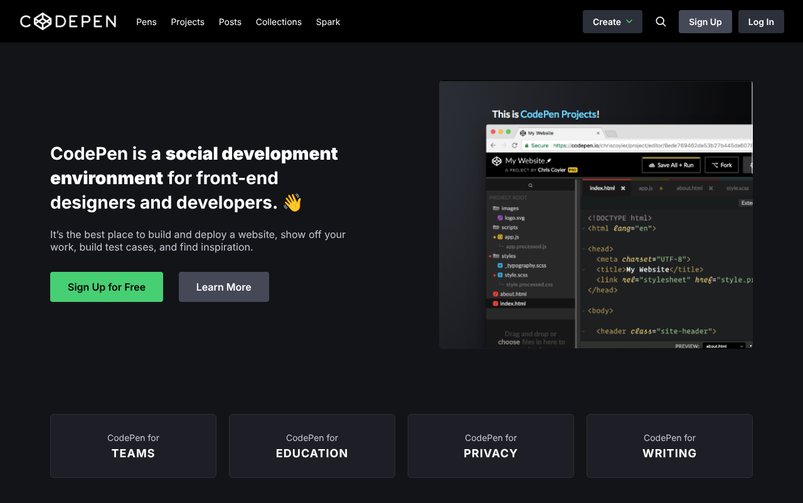

# Réplica de CodePen – Proyecto final CS100

Réplica de la página de inicio de CodePen.io realizada como proyecto final del curso
Coding Foundations (Bottega Coding Bootcamp · LANBIDE).

🔗 **Demo:** https://maialensarasola.github.io/cs100-codepen-replica-v2/

## Tecnologías
- HTML5
- CSS3 (Flexbox)
- Iconos SVG en línea

## Qué he trabajado
- Maquetación fiel a un diseño real: estructura, tipografía, colores y espaciados
- Barra de navegación con botón desplegable e icono de búsqueda
- Sección principal en dos columnas con Flexbox
- Footer con tarjetas que ocupan todo el ancho de la página
- Organización de recursos (imágenes y logos) en el proyecto

## Autora
Maialen Sarasola
